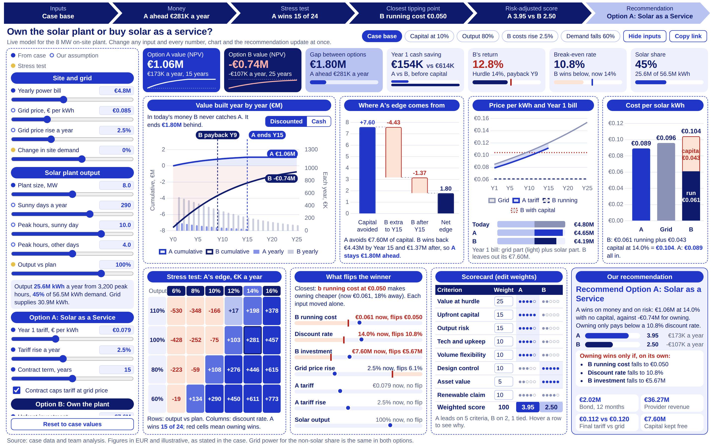

# Solar Investment Dashboard

A live, single-page decision dashboard for the case "Powering the Future: Choosing the Right Solar Energy Investment Model".
It compares **Option A: Solar Energy as a Service** with **Option B: CapEx ownership** of the 8 MW on-site plant.
Change any input and every number, chart and the recommendation update at once.



At the case values, the dashboard reproduces the presentation deck exactly:

| Output | Value |
|---|---|
| Option A value (NPV at 14%) | +€1.06M |
| Option B value (NPV at 14%) | -€0.74M |
| Yearly edge for A | €281K a year |
| Return on B's €7.6M | 12.8% (payback Year 9) |
| Cost per solar kWh: A / grid / B | €0.089 / €0.096 / €0.104 |
| Break-even discount rate | 10.8% |
| Weighted score: A / B | 3.95 / 2.50 |

Run `npm test` to check these numbers.

## What is on the page

- **Live verdict strip** (top): Inputs, Money, Stress test, Closest tipping point, Risk-adjusted score and Recommendation. A chevron turns red when that step favours ownership.
- **Key numbers with mini charts**: NPV of each option (with value-over-time sparklines), the gap, Year 1 cash saving, B's return against the hurdle, the break-even discount rate and the solar share of demand.
- **Value built year by year**: yearly savings bars plus cumulative value lines, with markers for B's payback year, the end of A's contract and any crossover. Switch between discounted and cash views.
- **Where A's edge comes from**: a waterfall from the €7.6M of capital avoided, minus B's extra savings up to Year 15 and after Year 15, to A's net edge.
- **Price per kWh and Year 1 bill**: grid price, A's tariff (shaded saving band), B's running cost and B's cost with capital, plus the Year 1 site bill under each option.
- **Cost per solar kWh**: A, grid and B, with B split into running cost and capital charge.
- **Stress test**: A's yearly edge over B across discount rates (6% to 16%) and solar output (60% to 110% of plan).
- **What flips the winner**: for seven inputs, the value at which the cheaper option changes, shown on a zone bar against today's value.
- **Risk-adjusted scorecard**: eight criteria with editable weights. The value score updates from the financial result.
- **Recommendation**: plain-English verdict with the reason, what would have to be true for the other option, and contract figures (bond size, provider revenue, final-year tariff, capital kept free).

### Inputs you can change

Site and grid (bill, grid price, grid price rise, change in demand), solar output (plant size, sunny days, full-output hours, output vs plan),
Option A (tariff, tariff rise, term, grid-price cap), Option B (investment, running cost, running-cost rise, plant life) and the discount rate.
Each input is marked as from the case, our assumption, or a stress test.

### Useful controls

- **Scenario buttons**: Case base, Capital at 10%, Output 80%, B costs rise 2.5%, Demand falls 60%.
- **Hide inputs**: gives the charts the full width. Use this view for slide screenshots.
- **Copy link**: the page address stores every change, so a link opens the same scenario.
  Add `?view=present` to open with inputs hidden, for example `https://YOUR-APP.onrender.com/?view=present&discountRate=0.1`.

## Model logic (same as the deck)

- Demand = yearly bill ÷ grid price. Solar output = plant kW × (sunny days × sunny hours + other days × other hours) × output vs plan.
- Only the solar kWh differ between options. Grid power for the rest is the same in both and is left out.
- Saving A each year = solar kWh used × (grid price minus A tariff), for the contract term. With the cap on, the tariff never exceeds grid.
- Saving B each year = solar kWh used × grid price minus solar kWh generated × running cost, for the plant life, after the upfront investment.
  If demand falls below solar output, B still pays to run the plant but cannot use all of it.
- Values are discounted at the chosen rate. Options with different lives are compared per year (NPV ÷ annuity factor).
- The €0.061 is read as running cost, because the case lists the €7.6M investment as a separate line.

## Project structure

```
solar-dashboard/
  server.js            Express backend: serves the page and the API
  shared/model.js      Financial model, used by both the browser and the server
  public/index.html    Dashboard layout
  public/styles.css    HUL blue palette, Arial
  public/app.js        Controls, charts and live updates
  test/model.test.js   Checks the model against the deck numbers
  render.yaml          Render deployment settings
  package.json
```

## Run it on your computer

Needs Node.js 18 or later.

```
npm install
npm start
```

Open http://localhost:3000

## Put it on GitHub

1. Create a new repository on GitHub (for example `solar-investment-dashboard`).
2. Unzip this folder. Upload all files inside `solar-dashboard` to the repository root
   (on GitHub: Add file, Upload files, drag the contents in, Commit changes).
   Do not upload a `node_modules` folder.

## Deploy it on Render

**Option 1: Blueprint (uses render.yaml)**
1. Sign in at render.com and choose New, then Blueprint.
2. Connect your GitHub account and pick the repository.
3. Render reads `render.yaml` and creates the web service. Click Apply.

**Option 2: Web Service by hand**
1. New, then Web Service, then pick the repository.
2. Runtime: Node. Build command: `npm install`. Start command: `npm start`.
3. Instance type: Free. Create Web Service.

After a few minutes the link appears at the top, for example `https://solar-investment-dashboard.onrender.com`.
On the free plan the service sleeps when unused; the first visit after a break can take about a minute to load.
Open the link once before you present.

## API

The same model is available as JSON:

- `GET /api/defaults`: case values and allowed ranges
- `GET /api/calculate?discountRate=0.10&outputFactor=0.8`: results for any inputs
- `POST /api/calculate` with a JSON body, for example `{"discountRate": 0.1, "weights": {"value": 30}}`
- `GET /health`: status check

Rates are written as decimals (14% is `0.14`). Money is in euros (€7.6M is `7600000`).
